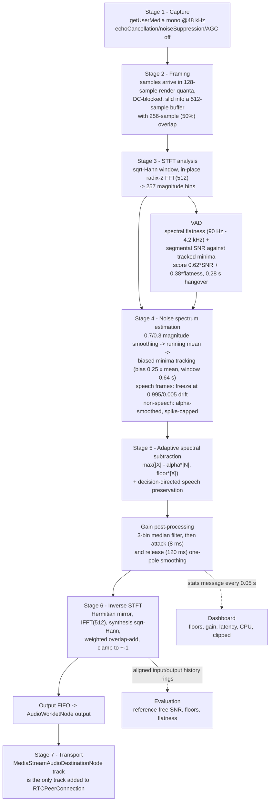

# The noise suppression algorithm

Everything here is transcribed from `src/worklets/noise-suppressor-worklet.js` (the processor
itself) plus the wiring in `src/audio/AudioEngine.ts`. If this document and the code disagree, the
code is right and this document has a bug.

**Design target:** a rider's voice must survive, everything that is not voice must drop, and the
whole thing must finish inside the 5.33 ms available per hop at 48 kHz - on the audio thread, with
no main-thread help and no external model.

---

## 1. Pipeline flowchart



The phase is deliberately untouched: the gain multiplies the real and imaginary parts, and bins
`N-k` are mirrored from `k` so the inverse transform is guaranteed real-valued.

## 2. The equations as implemented

Stage 3, analysis (window `w`, hop `H` = 256, `N` = 512):

```
X_k[m] = Σ_n  x[mH - n + ...] · w[n] · e^(-j2πkn/N)          k = 0 .. 256
|X_k[m]| = sqrt(Re² + Im²)
```

Stage 4, noise estimate. Smoothed magnitude, its long-window mean, and the biased minima:

```
S_k[m]      = 0.7 · S_k[m-1] + 0.3 · |X_k[m]|
Mean_k[m]   = 0.995 · Mean_k[m-1] + 0.005 · S_k[m]
Min_k       = S_k[m]                       if S_k[m] < Min_k
            = max(Min_k, 0.25 · Mean_k)    every 0.64 s window (MCRA-style upward bias)

noise_k[m]  = 0.995 · noise_k[m-1] + 0.005 · Min_k           during speech (floor must not rise)
            = β · noise_k[m-1] + (1-β) · min(S_k[m], 2.5 · noise_k[m-1])   otherwise
```

with `β = noiseSmoothing` (default 0.92). The spike cap is what stops a horn from being adopted as
the new noise floor, and the frozen drift during speech is what keeps a sustained vowel from
raising it.

VAD:

```
flatness = exp(mean log|X|) / mean|X|                     over 90 Hz .. 4.2 kHz
segSNR   = mean( S_k / (Min_k + ε) )
score    = 0.62 · clamp01((10·log10(segSNR) - 3) / 12) + 0.38 · clamp01((0.65 - flatness) / 0.45)
speech   = score ≥ vadThreshold, held for 0.28 s
```

Stage 5, the core subtraction (the specification's formula, verbatim in the code):

```
Enhanced Magnitude = max( Noisy Magnitude − alpha × Estimated Noise Magnitude , Spectral Floor )
|E_k| = max( |X_k| − alpha · noise_k , floor · |X_k| )
```

Speech preservation, using a decision-directed a priori SNR:

```
ξ_k[m] = 0.98 · ξ_k[m-1] + 0.02 · max( |X_k|²/noise_k² − 1, 0.001 )
pres   = speechPreservation · ξ_k / (ξ_k + 1)
|F_k|  = |E_k| · (1 − pres) + |X_k| · pres
g_k    = clamp(|F_k| / |X_k|, 0, 1)
```

Gain smoothing (musical-noise control):

```
ĝ_k = median3(g_k, g_k-1, g_k+1)
g_k[m] = a · g_k[m-1] + (1-a) · ĝ_k   if ĝ_k < g_k[m-1]   (attack, τ = attackMs)
       = r · g_k[m-1] + (1-r) · ĝ_k   otherwise            (release, τ = releaseMs)
a = exp(-H/(fs·attackMs)),  r = exp(-H/(fs·releaseMs))
```

Stages 6 and 7:

```
ŷ[n] = Σ_m  IFFT( X_k[m] · g_k ) [n] · w[n]        (OLA_SCALE = 1)
output = clamp(olaBuf[n] + ŷ[n], -1, 1)            clipped-sample counter increments at ±0.999
track  = MediaStreamAudioDestinationNode.getAudioTracks()[0]   ->  pc.addTrack(track)
```

## 3. Why sqrt-Hann (the detail that decides whether this works)

Analysis and synthesis both apply `w[n] = sqrt(0.5 - 0.5·cos(2πn/N))`, so the product of the two
windows is `w²`. With 50 % overlap a periodic window must satisfy the COLA condition
`w²[n] + w²[n+H] = 1`; `0.5-0.5cos(2πn/N)` has exactly that property, so `OLA_SCALE = 1` is
correct and the reconstruction is amplitude-flat.

This matters: with a plain (non-square-root) Hann on both sides the sum is `w[n]²+w[n+H]² = 1.5`
at the crossover, which produces a periodic amplitude ripple at the hop rate - audible as a
hollow, warbling voice. The reconstruction test in `tools/dsp-selftest.mjs` and
`tools/browser-check.html` is precisely the check that catches that class of bug: correlation
0.999 (Node) / 1.00000 (browser) between the input and a bypassed processor, residual −34.7 dB and
−141.5 dB respectively.

## 4. Parameters

Defaults come from `DEFAULT_NOISE_PARAMS` in `src/types/audio.ts`; ranges are the UI's slider
limits and the worklet's own clamps.

| Parameter | Range | Default | Effect |
| --- | --- | --- | --- |
| `reductionStrength` | 0 - 100 | 60 | the single "Noise reduction strength" control; mapped by `strengthToParams()` onto `overSubtraction` and `spectralFloor` |
| `overSubtraction` (alpha) | 1.0 - 4.0 | 2.0 | how aggressively the estimated noise is subtracted. Above ~3 the voice starts to sound thin and hollow |
| `spectralFloor` | 0.005 - 0.25 | 0.02 | minimum magnitude retained as a fraction of the noisy magnitude. Lower floors are quieter between words but generate more musical noise |
| `noiseSmoothing` (beta) | 0.80 - 0.995 | 0.92 | time constant of the noise tracker. High = steady, slow to chase a revving engine; low = chases fast, risks eating speech |
| `speechPreservation` | 0 - 0.9 | 0.25 | how much of the original bin is blended back where the a priori SNR is high |
| `attackMs` | 2 - 40 | 8 | how quickly suppression engages after speech ends. Fast attack suppresses the horn onset but clips consonant starts |
| `releaseMs` | 20 - 300 | 120 | how quickly gain returns when speech starts. Slow release adds pumping; fast release leaks noise transients |
| `vadThreshold` | 0.1 - 0.9 | 0.4 | decision level on the speech score; the 0.28 s hangover is fixed |
| `bypass` | on/off | off | A/B mode: the frame passes through with unity gain (A/B comparison tab and Evaluation) |

Structural constants, not user-tunable: `FFT_SIZE` 512, `HOP_SIZE` 256, `RENDER_QUANTUM` 128,
speech band 90 Hz - 4.2 kHz, `MIN_BIAS` 0.25, minima window 0.64 s, `DD_SMOOTH` 0.98, VAD weights
0.62/0.38, hangover 0.28 s, DC pole 0.995 (≈38 Hz at 48 kHz).

## 5. Latency

| Component | Value | Where it comes from |
| --- | --- | --- |
| STFT algorithmic delay | `N/fs` = 512/48000 = **10.67 ms** | reported in `stats.algorithmLatencyMs` |
| Frame pipeline (primer + lookahead + FIFO) | measured 511 samples in the bypass test | `tools/dsp-selftest.mjs` |
| Per-hop compute | 0.030 ms measured for 5.33 ms of budget | `stats.frameProcessingMs` |
| Audio-thread load | 0.6 % measured | `stats.cpuLoad` |
| Device scheduling | `AudioContext.baseLatency` + `outputLatency` | shown separately, never folded into the algorithm number |

## 6. Deliberate choices worth defending

- **Everything on the audio thread.** No `ScriptProcessorNode`, no main-thread DSP, so a busy
  React render cannot glitch the call. The main thread only receives statistics every 50 ms.
- **Gain-domain filtering with original phase.** Magnitude-only subtraction with a preserved
  phase is the classic approach; it is cheaper than a Wiener/Mask-based model and needs no
  training data, which is what the specification asks for.
- **Two-sided noise protection.** During speech the floor can only drift down toward the tracked
  minimum (0.995/0.005); outside speech it can only move by 2.5× per step. Together these stop the
  two classic failure modes - speech raising the floor (voice disappears) and noise transients
  becoming the floor (noise comes back).
- **A limiter with a counter, not a compressor.** Output clamps to ±1 and increments
  `stats.clipped`, so over-subtraction that would produce digital distortion is visible rather than
  silently smoothed. Measured runs report 0 clipped samples.
- **Reference-free evaluation only.** The engine keeps time-aligned input/output rings
  (`histIn`/`histOut`, 4 s) and hands back an aligned pair on request. Metrics are computed from
  those buffers. When a floor is digital silence, or no frame passed the gate, the metric returns
  `NaN` and the UI prints `--` / "not measurable" instead of inventing a number.
- **The processed track is the only track.** `getProcessedTrack()` returns the
  `MediaStreamAudioDestinationNode` track; `CallController` refuses to dial or accept when it is
  `null`. There is no code path that can put the raw microphone on the wire.
