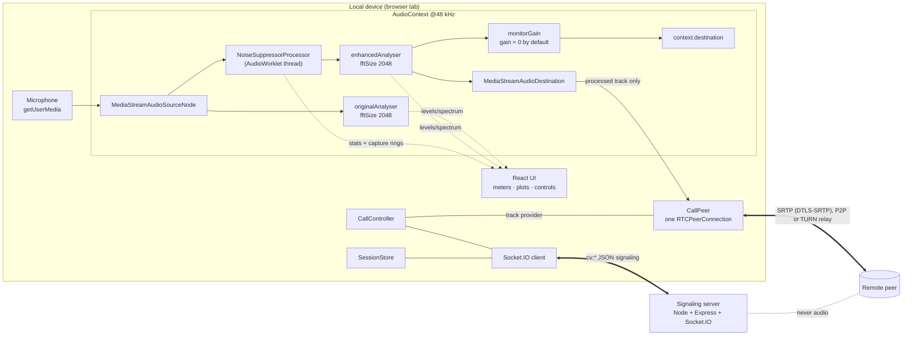
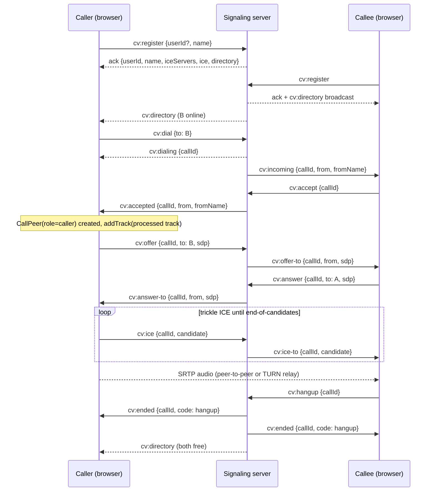
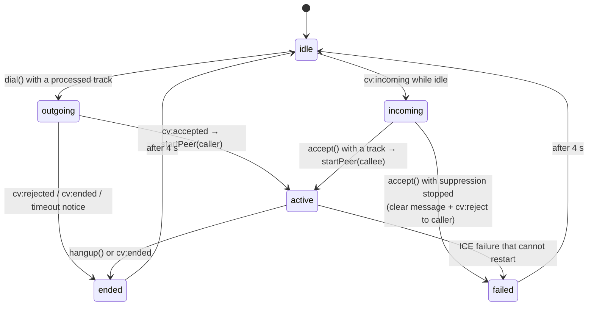

# Architecture

How ClearVoice is put together, and why each boundary sits where it does. Every name below is a
real file, class or event in this repository.

---

## 1. System view



Two things leave the device and they leave by different doors:

| Wire | Content | Size on the wire |
| --- | --- | --- |
| WebRTC media (SRTP) | the **processed** audio track | continuous, encrypted, peer-to-peer or via TURN |
| Socket.IO signaling | ids, names, SDP strings, ICE candidates, call codes | ≤ 243 bytes per frame measured in `npm run test:signaling` |

The server has no media path at all - it never receives a buffer of audio.

## 2. Module map

### Frontend

| Module | Responsibility | Why it is a module-level singleton |
| --- | --- | --- |
| `src/audio/AudioEngine.ts` | owns the `AudioContext`, the graph, parameters, snapshot accounting | a second graph would mean two microphones and two processors |
| `src/audio/NoiseSuppressor.ts` | loads the worklet module, forwards `params`, fans out `stats` and `capture-result` messages | one node, one port |
| `src/audio/AudioCapture.ts` | `getUserMedia` with fixed constraints, capability probes, device list | - |
| `src/audio/evaluation.ts` | reference-free metrics computed from the aligned original/enhanced rings | - |
| `src/worklets/noise-suppressor-worklet.js` | the algorithm itself (see docs/algorithm.md) | runs on the audio thread |
| `src/services/socketService.ts` | one Socket.IO client, `emit`/`on` wrappers, register handshake | a re-mount must not open a second socket |
| `src/services/sessionStore.ts` | identity, directory, ICE config, status; persists id + name in `localStorage` | one presence per tab |
| `src/services/callController.ts` | the call state machine; bridges signaling events to `CallPeer` | two peer connections for one call is a bug |
| `src/services/webrtcService.ts` | `CallPeer`: negotiation, trickle ICE with a pending queue, recovery, `getStats()` | - |
| `src/services/callHistory.ts` | last-call log in `localStorage` | - |
| `src/hooks/use*` | `useSyncExternalStore` views over the singletons + bound callbacks | components stay stateless |
| `src/pages/*` | Dashboard, Audio processing, Voice calling, A/B comparison, Evaluation | - |

Why singletons instead of context: React StrictMode and route/tab switches re-mount components.
If the socket, the audio graph or the peer connection lived in a component, each re-mount would
create a new one. Keeping them at module scope and subscribing through `useSyncExternalStore`
makes duplicate listeners structurally impossible - the requirement "no duplicate audio streams,
peer connections or Socket.IO listeners" is enforced by construction, not by a check.

### Backend

| File | Responsibility |
| --- | --- |
| `server/index.js` | HTTP + Socket.IO bootstrap, CORS allow-list, `nosniff`, `GET /health`, `GET /config/ice` (masked), SIGTERM drain |
| `server/socket/callHandlers.js` | registration and presence, directory broadcast, call state machine, authorised SDP/ICE relay, validation, rate limiting, disconnect cleanup |
| `server/config/iceServers.js` | reads `STUN_URL`, `STUN_URL_2`, `TURN_URL`, `TURN_USERNAME`, `TURN_CREDENTIAL`; reports status without exposing secrets |

## 3. Signaling sequence



Rejected, unanswered and lost calls take the same teardown path: the server emits `cv:ended` (or
`cv:rejected`) with a code, and both clients run `CallController.teardown(reason)` so no socket
listener, peer connection or stats timer can outlive the call.

## 4. Client call state machine

`CallController` is the only place call state lives. `phase` values and their transitions:



Guards that are easy to get wrong and are therefore explicit in the code:

- `dial()`/`accept()` refuse to start without `getProcessedTrack()`; they never fall back to the
  raw microphone.
- `startPeer()` returns immediately if a peer already exists - a duplicated `cv:accepted` cannot
  create a second `RTCPeerConnection`.
- every signaling handler ignores payloads whose `callId` is not the current call.
- incoming calls that arrive while busy are answered with `cv:reject` from the server side.
- teardown records the call locally, closes the peer, stops the 1 Hz stats timer, and resets to a
  clean idle after four seconds.

## 5. Connection recovery

`CallPeer` watches `connectionState`, `iceConnectionState` and `signalingState`. On `failed`, or on
`disconnected` when no restart has been attempted, it calls `restartIce()` **once**
(`restartAttempted`) and reports the attempt through the failure channel, which the UI renders as a
notice. If a restart is not possible it says so instead of looping. Remote ICE candidates that
arrive before the remote description is set are queued in `pendingIce` and drained right after
`setRemoteDescription`, which is what makes trickle ICE safe when the signaling and the ICE
gatherers race each other.

`getStats()` is read once per second and mapped onto the metrics panel: packets sent/lost, loss
percent, jitter, RTT from the nominated (or transport-selected) candidate pair, mean jitter-buffer
delay from `jitterBufferDelay / jitterBufferEmittedCount`, codec, and the candidate-type resolution
(`host → srflx`, `prflx → relay`, ...). Nothing on that panel is estimated locally.

## 6. Server-side call model

```
calls: callId -> { id, caller, callee, state: 'ringing' | 'active' }
users: socketId -> { id, name, socketId, inCall }
byUserId: userId -> socketId
```

- one call per user (`inCall` flag), released by accept-and-end, reject, hangup, or disconnect;
- `cv:offer` / `cv:answer` / `cv:ice` are relayed **only** between the two participants, otherwise
  `forbidden`;
- SDP is capped at 20 000 characters, ICE must be an object or `null`, ids must match
  `^[A-Za-z0-9_-]{2,24}$`, names are control-character-stripped and capped at 32;
- a per-socket token bucket at 60 messages/second returns `cv:error {code: 'rate-limited'}`;
- on `disconnect`, an in-flight call is closed and the peer gets `cv:peer-lost`;
- re-registering on the same socket (a page reload) releases the previous identity first, so
  signaling addressed to the abandoned id cannot keep landing on this connection. That behaviour
  is asserted by `npm run test:signaling` ("a reload does not leave the abandoned id in the
  directory").

## 7. Latency accounting

The UI separates three numbers that are routinely conflated:

| Metric | Source | Meaning |
| --- | --- | --- |
| Algorithmic latency | `FFT_SIZE / sampleRate` computed on the audio thread | unavoidable STFT window delay (512/48000 ≈ 10.7 ms) |
| Graph latency | `AudioContext.baseLatency` + `outputLatency` | device scheduling |
| Network latency | `currentRoundTripTime` from `getStats()` | only exists during a call |

Pipeline delay shown as "what the far end experiences" is algorithmic + graph; RTT is reported
separately so a slow link is never blamed on the DSP.

## Deviations from the original module listing

The specification's structure was kept, with these additions. None changes the mandated stack:

| Deviation | Reason |
| --- | --- |
| Dashboard page lives in `src/pages/Dashboard.tsx`, not `components/Dashboard.tsx` | it is a routed view; components under `src/components` are shared presentational pieces |
| `services/sessionStore.ts` and `services/callController.ts` split out of one "WebRTC service" | presence and call control have different lifetimes; splitting is what makes the singleton guarantees testable |
| `services/callHistory.ts`, `audio/evaluation.ts`, `types/call.ts`, `types/audio.ts` | small dedicated owners for the local log, the reference-free metrics and the shared contracts |
| `tools/` harnesses (`dsp-selftest.mjs`, `signaling-test.mjs`, `browser-check.html`, `mock-peer.mjs`) | the specification requires measured evidence; these produce it reproducibly and are excluded from the app bundle |
| `useSocket` reads `sessionStore` instead of owning state | keeps one socket per tab |
